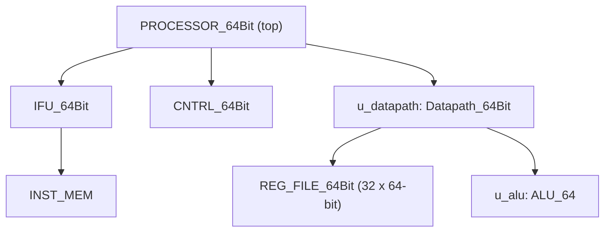

# 64-bit RISC-V Processor on Kintex-7

A 64-bit RISC-V processor core written in Verilog, targeting the Xilinx Kintex-7 `xc7k480tiffg1156-2L` FPGA.

**Tags:** RTL Design · Verilog · Verification · FPGA

## Overview

The core is split into an instruction fetch unit with its instruction memory, a control unit, and a datapath that combines a 32-entry 64-bit register file with a 64-bit ALU (adder, XOR and a 64 x 64-bit multiplier). Each block has its own unit testbench.

A board-level wrapper around the processor SoC adds:

- button and switch synchronizers
- a heartbeat counter
- lane-select and hold logic
- an activity stretcher
- an LED / Pmod output multiplexer

This lets internal values be viewed on a board. The SoC bus interface is exercised in simulation with AXI4-Lite style write and read transactions.

## Target Device

| Item | Value |
| --- | --- |
| Device | xc7k480tiffg1156-2L (Kintex-7 480T, industrial temperature) |
| Package / speed grade | FFG1156 / -2L |
| Tool | Vivado v2026.1 (win64), Build 6511674 |
| Processor top module | `PROCESSOR_64Bit` |
| Simulation top module | `ALU_64Bit_tb` |
| Device resources | 298,600 LUTs, 597,200 flip-flops, 955 RAMB36, 1,920 DSP48E1, 8 MMCM, 400 bonded IOB |

## Architecture

`PROCESSOR_64Bit` instantiates three blocks:

- **`IFU_64Bit`**: the instruction fetch unit, containing the instruction memory `INST_MEM`
- **`CNTRL_64Bit`**: the control unit
- **`Datapath_64Bit`** (instance `u_datapath`): contains the register file `REG_FILE_64Bit` and the 64-bit ALU `ALU_64` (instance `u_alu`)

The instruction memory uses only the low 6 bits of the program counter (`PC[31:6]` are unused).



*Module hierarchy of the processor, as elaborated by Vivado.*


*Synthesized schematic of the board-level wrapper: 357 cells, 19 I/O ports and 2,251 nets, with the SoC instance `u_soc` and the debug display logic.*

### Subcomponents

The processor contains **6 sub-modules** under the top module (3 direct children and 3 nested), 7 modules in total:

| # | Module | Level | Source file | Function |
| --- | --- | --- | --- | --- |
| 1 | `IFU_64Bit` | Child of top | `IFU_64Bit.v` | Instruction fetch and program counter |
| 2 | `INST_MEM` | Inside IFU | `INST_MEM.v` | Instruction memory (addressed by the low 6 PC bits) |
| 3 | `CNTRL_64Bit` | Child of top | `CNTRL_64Bit.v` | Control unit |
| 4 | `Datapath_64Bit` (`u_datapath`) | Child of top | `Datapath_64Bit.v` | Datapath joining the register file and the ALU |
| 5 | `REG_FILE_64Bit` | Inside datapath | `REG_FILE_64Bit.v` | 32 x 64-bit register file |
| 6 | `ALU_64` (`u_alu`) | Inside datapath | `ALU_64.v` | 64-bit arithmetic and logic unit |

`INST_MEM_64Bit.v` is a separate instruction-memory variant kept in the project for its own unit test.

Vivado's RTL analysis of the core lists: 32 x 64-bit registers (the register file), one 64 x 64-bit multiplier, one 2-input and one 3-input 64-bit adder, one 64-bit XOR, 32 x 2-input 1-bit multiplexers and one 10-input 1-bit multiplexer.

## Parameters

The modules are not parameterized (the synthesis log reports no parameter bindings). Key sizes are fixed in the RTL:

| Item | Value |
| --- | --- |
| Data / ALU width | 64 bits |
| Register file | 32 registers x 64 bits |
| ALU multiplier | 64 x 64 bits |
| Program counter bits used by the instruction memory | 6 (`PC[5:0]`) |
| Clock constraint | 10.000 ns (100 MHz) |

## Internal Registers and Signals

| Name | Width | Purpose |
| --- | --- | --- |
| Register file storage | 32 x 64 | General-purpose registers inside `REG_FILE_64Bit` |
| `ALU_RSLT0` | 64 x 64 product | Multiplier output inside `ALU_64`, mapped to DSP48E1 blocks |
| `ALU_RSLT_reg` | 64 | ALU result register |
| `PC` | 32 (6 used by the memory) | Program counter input to `INST_MEM` |

## User I/O

Board-level wrapper (from the synthesized schematic): **19 I/O ports**.

| Signal | Direction | Bits |
| --- | --- | --- |
| `CLK125MHZ` | In | 1 |
| `SW[1:0]` | In | 2 |
| `BTN[3:0]` | In | 4 |
| `LED[3:0]` | Out | 4 |
| `JB[7:0]` | Out | 8 |

Processor and block-level ports named in the constraint file:

- **Inputs:** `A`, `B`, `ALUControl`, `PC`, `RST`, `CLK`
- **Outputs:** `ALUResult`, `INST_CODE`, `OUTPUT`, `ZERO`

## Results

### Synthesis

Vivado's DSP report shows that the 64 x 64-bit multiplier in `ALU_64` is built from **16 DSP48E1 slices** (0.83% of the 1,920 on the device), in chains of the forms `A*B`, `PCIN+A*B` and `(PCIN>>17)+A*B`. Synthesis finished with 0 errors, 0 critical warnings and 81 warnings.

### Timing

All user-specified timing constraints are met: worst setup slack is +7.257 ns, worst hold slack is +0.069 ns and worst pulse-width slack is +2.000 ns, with no failing endpoints.

| Check | Worst slack | Total negative slack | Failing endpoints | Total endpoints |
| --- | --- | --- | --- | --- |
| Setup (WNS / TNS) | 7.257 ns | 0.000 ns | 0 | 23,787 |
| Hold (WHS / THS) | 0.069 ns | 0.000 ns | 0 | 23,787 |
| Pulse width (WPWS / TPWS) | 2.000 ns | 0.000 ns | 0 | 8,376 |


*Vivado Design Timing Summary (routed design).*

### Power

Total on-chip power is 0.712 W. The clocking block (MMCM) accounts for 56% of the 0.191 W dynamic power, and static power is 73% of the total. This run used its own operating conditions, shown in the table (5 W budget, 50 °C junction temperature, 46.741 °C ambient).

| Metric | Value |
| --- | --- |
| Total on-chip power | 0.712 W |
| Dynamic power | 0.191 W (27%) |
| Dynamic: clocks | 0.012 W (6%) |
| Dynamic: signals | 0.030 W (16%) |
| Dynamic: logic | 0.024 W (12%) |
| Dynamic: block RAM | 0.016 W (8%) |
| Dynamic: MMCM | 0.106 W (56%) |
| Dynamic: I/O | 0.004 W (2%) |
| Device static power | 73% of total |
| Design power budget / margin | 5 W / 4.288 W |
| Junction temperature | 50.0 °C |
| Thermal margin | 35.0 °C (6.3 W) |
| Ambient temperature | 46.741 °C |
| Effective θJA | 4.6 °C/W |
| Power supplied to off-chip devices | 0 W |
| Process | typical |
| Confidence level | Medium |


*Vivado power analysis of the implemented netlist.*

## Constraints (XDC)

`Combined_64bit.xdc` is a single constraint file shared by `PROCESSOR_64Bit`, `ALU_64Bit`, `IFU_64Bit` and `INST_MEM_64Bit`. It defines:

- a 10 ns clock on `CLK`
- a virtual clock `vclk` used for study-mode I/O timing (input delays 0.5 to 2.0 ns, output delays 0.0 to 2.0 ns)
- default power-analysis conditions (typical process, 15 W budget, 25 °C ambient) with switching activity on the input and output ports

```tcl
create_clock -period 10.000 -name clk [get_ports CLK]
create_clock -period 10.000 -name vclk
set_input_delay  -clock vclk -max 2.000 [all_inputs]
set_input_delay  -clock vclk -min 0.500 [all_inputs]
set_output_delay -clock vclk -max 2.000 [all_outputs]
set_output_delay -clock vclk -min 0.000 [all_outputs]

# Power analysis conditions
set_operating_conditions -process typical
set_operating_conditions -design_power_budget 15.0
set_operating_conditions -ambient_temp 25.0
set_switching_activity -deassert_resets
set_switching_activity -toggle_rate 5.000  -static_probability 0.500 [get_ports -quiet {A* B* ALUControl* PC* RST}]
set_switching_activity -toggle_rate 10.000 -static_probability 0.500 [get_ports -quiet {ALUResult* INST_CODE* OUTPUT* ZERO*}]
set_load 2.000 [all_outputs]
set_property LOAD 2 [get_ports ZERO]
```

## Verification

Each main block has its own testbench: `ALU_64Bit_tb` (the simulation top), `IFU_64Bit_tb`, `INST_MEM_64Bit_tb` and `Datapath_64Bit_tb`.

The waveform below shows AXI4-Lite style activity at the SoC bus interface for 315 ns. After `rst_n` is released, the testbench performs:

1. Two write transactions: address `0x4` with data `0xaabbccdd`, then address `0x8` with data `0x11223344` (byte strobes `0xf`), each followed by a write response (`bvalid`).
2. Two read transactions at the same addresses, each returning a read response (`rvalid`).


*Simulation waveform, 0 to 315 ns.*

## Project Files

```
.
├── rtl/
│   ├── PROCESSOR_64Bit.v
│   ├── IFU_64Bit.v
│   ├── INST_MEM.v
│   ├── INST_MEM_64Bit.v
│   ├── CNTRL_64Bit.v
│   ├── REG_FILE_64Bit.v
│   ├── ALU_64.v
│   └── Datapath_64Bit.v
├── tb/
│   ├── ALU_64Bit_tb.v
│   ├── IFU_64Bit_tb.v
│   ├── INST_MEM_64Bit_tb.v
│   └── Datapath_64Bit_tb.v
├── constraints/
│   └── Combined_64bit.xdc
└── docs/
    └── images/
```

The `rtl/`, `tb/` and `constraints/` folders above are a suggested layout; adjust them to match your repository.

## Author

Aravindakshan GA, an aspiring VLSI Design Verification Engineer.
