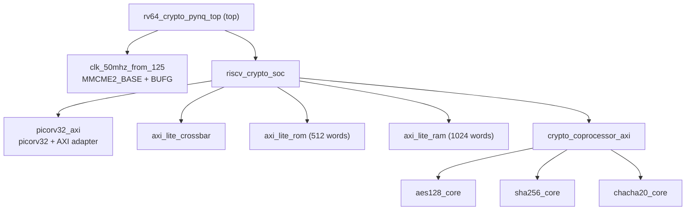

# RISC-V Crypto SoC on a Virtex-7 FPGA

A small RISC-V system-on-chip written in Verilog: a PicoRV32 core, an AXI4-Lite crossbar, a boot ROM, a RAM and a hardware crypto coprocessor (AES-128, SHA-256, ChaCha20). It is built with Vivado v2026.1 for a Virtex-7 VX485T (project name: `64_bit_RISCV`).

**Tags:** RTL Design · Verilog · RISC-V · AXI4-Lite · Crypto · FPGA

> **Scope note.** The project is named 64_bit_RISCV, but the synthesized core is PicoRV32, which is a 32-bit RISC-V core (32 x 32-bit register file, 32-bit AXI4-Lite ports). Results below come from a Vivado run on 20 Oct 2026.

## Overview

`PicoRV32` (wrapped as `picorv32_axi`) is the bus master. It reaches a boot ROM, a RAM and a crypto coprocessor through an AXI4-Lite crossbar. The coprocessor wraps three cores: AES-128, SHA-256 and ChaCha20.

A board-level top module, `rv64_crypto_pynq_top`, generates a 50 MHz system clock from the 125 MHz board clock with an MMCM. It adds button and switch synchronizers, a heartbeat counter, lane-select and hold logic, an activity stretcher and an LED / Pmod output multiplexer, so internal values can be viewed on a board.

## Target Device

| Item | Value |
| --- | --- |
| Device | xc7vx485tffg1930-2 (Virtex-7 VX485T) |
| Package / speed grade | FFG1930 / -2 |
| Tool | Vivado v2026.1 (win64), Build 6511674 |
| Top module | `rv64_crypto_pynq_top` |
| Simulation top | `tb_axi_lite_mem` |
| Constraint file | `pynq_zc.xdc` |
| Device resources | 303,600 LUTs, 607,200 flip-flops, 1,030 RAMB36, 2,800 DSP, 14 MMCM, 700 bonded IOB |

## Architecture



*Module hierarchy from the Vivado synthesis log.*

**Clocking.** The 125 MHz board clock (`sys_clk_pin`, 8.000 ns) feeds one MMCM (multiply 8, output divide 20) that produces the 50 MHz `clk50_mmcm` (20.000 ns) used by the SoC. The PicoRV32 hardware multiplier and divider are disabled, so the design uses 0 DSP slices.


*Synthesized schematic of the board-level wrapper: 357 cells, 19 I/O ports and 2,251 nets.*

## Source Files

| Source file | Modules | Function |
| --- | --- | --- |
| `Pynq_z2_top.v` | `rv64_crypto_pynq_top`, `clk_50mhz_from_125` | Board-level wrapper and 50 MHz clock generator |
| `riscv_crypto_soc.v` | `riscv_crypto_soc` | SoC integration |
| `picorv32.v` | `picorv32`, `picorv32_axi`, `picorv32_axi_adapter` | RISC-V core and its AXI4-Lite master adapter |
| `axi_lite_crossbar.v` | `axi_lite_crossbar` | AXI4-Lite interconnect |
| `axi_lite_mem.v` | `axi_lite_rom`, `axi_lite_ram` | Boot ROM (512 words) and RAM (1,024 words) |
| `crypto_coprocessor_axi.v` | `crypto_coprocessor_axi` | Coprocessor AXI4-Lite interface |
| `aes128_core.v` | `aes128_core` | AES-128 core |
| `sha256_core.v` | `sha256_core` | SHA-256 core |
| `chacha20_core.v` | `chacha20_core` | ChaCha20 core |

Module functions follow module and file names; the RTL itself was not in the archive used to write this.

## Parameters

| Module | Parameter | Value |
| --- | --- | --- |
| MMCME2_BASE | CLKIN1_PERIOD / CLKFBOUT_MULT_F / CLKOUT0_DIVIDE_F | 8.0 ns / 8.0 / 20.0 |
| axi_lite_rom | MEM_WORDS / INIT_FILE | 512 / `boot_rom.hex` |
| axi_lite_ram | MEM_WORDS | 1024 |
| picorv32_axi | PROGADDR_RESET / STACKADDR | 0 / 268439552 (0x10001000) |
| picorv32 | ENABLE_MUL / ENABLE_DIV / ENABLE_IRQ / COMPRESSED_ISA | 0 / 0 / 0 / 0 |
| picorv32 | ENABLE_REGS_16_31 / ENABLE_REGS_DUALPORT | 1 / 1 |
| picorv32 | TWO_STAGE_SHIFT / BARREL_SHIFTER | 1 / 0 |
| picorv32 | CATCH_MISALIGN / CATCH_ILLINSN | 1 / 1 |
| picorv32 | PROGADDR_IRQ / MASKED_IRQ / LATCHED_IRQ | 16 / 0 / -1 |

## User I/O

| Signal | Direction | Bits | Pin (as written in XDC) |
| --- | --- | --- | --- |
| `CLK125MHZ` | In | 1 | H16 |
| `BTN[3:0]` | In | 4 | D19, D20, L20, L19 |
| `SW[1:0]` | In | 2 | M20, M19 |
| `LED[3:0]` | Out | 4 | R14, P14, N16, M14 |
| `JB[7:0]` | Out | 8 | W14, Y14, T11, T10, V16, W16, V12, W13 |

19 port bits in total: 7 input buffers and 12 output buffers (19 of 700 bonded IOBs, 2.71%).

## Results

### Utilization (placed design)

| Resource | Used | Available | Util % |
| --- | --- | --- | --- |
| Slice LUTs | 9,260 | 303,600 | 3.05 |
| Slice registers (FFs) | 8,236 | 607,200 | 1.36 |
| F7 / F8 muxes | 165 / 68 | 151,800 / 75,900 | 0.11 / 0.09 |
| Slices | 3,060 | 75,900 | 4.03 |
| Block RAM tiles (23 x RAMB18) | 11.5 | 1,030 | 1.12 |
| DSP | 0 | 2,800 | 0.00 |
| Bonded IOB | 19 | 700 | 2.71 |
| BUFGCTRL / MMCME2_ADV | 2 / 1 | 32 / 14 | 6.25 / 7.14 |

All 14,758 routable nets are fully routed with 0 routing errors.

### Timing

All user-specified timing constraints are met.

| Check | Worst slack | Total negative slack | Failing endpoints | Total endpoints |
| --- | --- | --- | --- | --- |
| Setup (WNS / TNS) | 7.257 ns | 0.000 ns | 0 | 23,787 |
| Hold (WHS / THS) | 0.069 ns | 0.000 ns | 0 | 23,787 |
| Pulse width (WPWS / TPWS) | 2.000 ns | 0.000 ns | 0 | 8,376 |


### Power

Total on-chip power is 0.712 W (typical process). Static power is 73% of the total, and the MMCM accounts for 56% of the 0.191 W dynamic power.

| Metric | Value |
| --- | --- |
| Total on-chip power | 0.712 W |
| Dynamic / static | 0.191 W (27%) / 0.521 W (73%) |
| Dynamic: clocks / signals / logic | 0.012 W / 0.030 W / 0.024 W |
| Dynamic: block RAM / MMCM / I/O | 0.016 W / 0.106 W / 0.004 W |
| Design power budget / margin | 5 W / 4.288 W |
| Junction temperature | 50.0 °C |
| Ambient temperature (this run) | 46.741 °C |
| Effective θJA | 4.6 °C/W |
| Confidence level | Medium |


## Constraints (`pynq_zc.xdc`, excerpt)

```tcl
set_input_jitter [get_clocks sys_clk_pin] 0.010

# Power analysis conditions
set_operating_conditions -process typical
set_operating_conditions -design_power_budget 5.0
set_operating_conditions -junction_temp 50.0
set_operating_conditions -ambient_temp 25.0
set_operating_conditions -airflow 0 -heatsink none
set_switching_activity -toggle_rate 0.500  -static_probability 0.500 [get_ports {{BTN[*]} {SW[*]}}]
set_switching_activity -toggle_rate 1.000  -static_probability 0.500 [get_ports {LED[*]}]
set_switching_activity -toggle_rate 10.000 -static_probability 0.500 [get_ports {JB[*]}]
set_switching_activity -default_toggle_rate 12.5 -default_static_probability 0.5
set_switching_activity -deassert_resets
set_load 5.000 [all_outputs]
```

## Verification

`tb_axi_lite_mem` exercises the AXI4-Lite ROM and RAM in the Vivado simulator (315 ns). After `rst_n` is released it performs two writes (address `0x4` with data `0xaabbccdd`, then `0x8` with `0x11223344`, byte strobes `0xf`), each followed by a write response, then two reads at the same addresses, each returning a read response.


## Known Limitations

- **Boot ROM image:** `boot_rom.hex` cannot be opened in synthesis or simulation, so the ROM is not initialised.
- **Constraints vs. device:** `pynq_zc.xdc` uses PYNQ-Z2 pins and LVCMOS33, but the Vivado part is `xc7vx485tffg1930-2`. 12 of 19 ports have no pin location and all 19 use the default I/O standard (DRC NSTD-1 and UCIO-1), so no bitstream is generated.
- **Simulation log:** it prints two split-write mismatch lines (upper 32 bits read as `z`) before reporting a pass, and the testbench drives 64-bit signals into 32-bit ports.
- **Verification scope:** only the memory testbench is active. The crossbar, crypto cores and firmware testbenches exist in the project but are disabled and have no recorded results.

## Author

Aravindakshan GA, an aspiring VLSI Design Verification Engineer.
